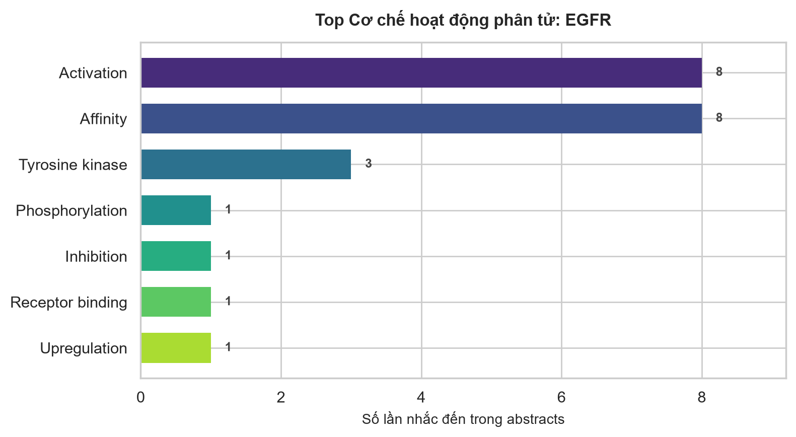
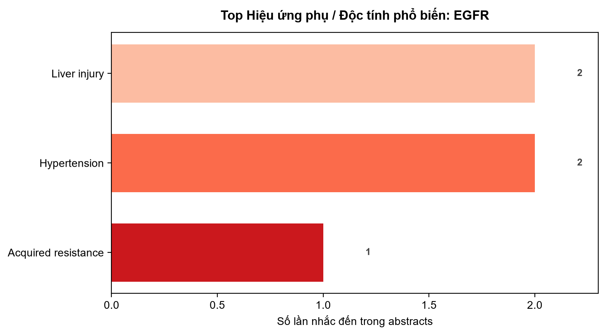

# BÁO CÁO NGHIÊN CỨU PROTEIN: EGFR

- **Tên chính thức:** Epidermal growth factor receptor
- **Mã UniProt:** [P00533](https://www.uniprot.org/uniprotkb/P00533)
- **Gen:** EGFR
- **Sinh vật:** Homo sapiens
- **Mã cấu trúc 3D (RCSB PDB):** [8A27](https://www.rcsb.org/structure/8A27)

## 1. Cách Thức Hoạt Động & Chức Năng Sinh Học

Receptor tyrosine kinase binding ligands of the EGF family and activating several signaling cascades to convert extracellular cues into appropriate cellular responses (PubMed:10805725, PubMed:12297050, PubMed:12620237, PubMed:12873986, PubMed:15374980, PubMed:15590694, PubMed:17115032, PubMed:19560417, PubMed:21258366, PubMed:27153536, PubMed:2790960, PubMed:35538033, PubMed:9488479). Known ligands include EGF, TGFA/TGF-alpha, AREG, epigen/EPGN, BTC/betacellulin, epiregulin/EREG and HBEGF/heparin-binding EGF (PubMed:12297049, PubMed:15611079, PubMed:17909029, PubMed:20837704, PubMed:27153536, PubMed:2790960, PubMed:7679104, PubMed:8144591, PubMed:9419975). Ligand binding triggers receptor homo- and/or heterodimerization and autophosphorylation on key cytoplasmic residues (PubMed:10026169, PubMed:17349580, PubMed:18046415, PubMed:19560417, PubMed:19836242). The phosphorylated receptor recruits adapter proteins like GRB2 which in turn activates complex downstream signaling cascades (PubMed:10026169, PubMed:17349580, PubMed:18046415, PubMed:19560417, PubMed:19836242). Activates at least 4 major downstream signaling cascades including the RAS-RAF-MEK-ERK, PI3 kinase-AKT, PLCgamma-PKC and STATs modules (PubMed:27153536). May also activate the NF-kappa-B signaling cascade (PubMed:11116146). Also directly phosphorylates other proteins like RGS16, activating its GTPase activity and probably coupling the EGF receptor signaling to the G protein-coupled receptor signaling (PubMed:11602604). Also phosphorylates MUC1 and increases its interaction with SRC and CTNNB1/beta-catenin (PubMed:11483589). Positively regulates cell migration via interaction with CCDC88A/GIV which retains EGFR at the cell membrane following ligand stimulation, promoting EGFR signaling which triggers cell migration (PubMed:20462955). Acts as a positive regulator of cGAS-STING signaling by mediating tyrosine phosphorylation of STING1, promoting production of type I interferon (IFN-alpha and IFN-beta), while inhibiting STING1 ability to regulate autophagy (PubMed:32926474). Plays a role in enhancing learning and memory performance (By similarity). Plays a role in mammalian pain signaling (long-lasting hypersensitivity) (By similarity)
May act as an antagonist of EGF action
(Microbial infection) Acts as a receptor for hepatitis C virus (HCV) in hepatocytes and facilitates its cell entry. Mediates HCV entry by promoting the formation of the CD81-CLDN1 receptor complexes that are essential for HCV entry and by enhancing membrane fusion of cells expressing HCV envelope glycoproteins

## 2. Phân Tích Cơ Chế Hoạt Động Từ Y Văn (PubMed)

### Dẫn chứng cơ chế từ các nghiên cứu gần nhất:
- **[PMID:42456909 - 2027]**: "Both in vitro and in vivo experiments confirmed that AS-IV exerted a protective effect against ethanol-induced gastric injury by inhibiting the abnormal activation of the PI3K/Akt/NF-κB signaling pathway mediated by EGFR."
- **[PMID:42431285 - 2027]**: "The observation that LY294002 attenuated the protective effects of FS herb pair provides pharmacological evidence consistent with a role for PI3K/AKT/mTOR activation in FS-mediated hepatoprotection."
- **[PMID:42431285 - 2027]**: "It dually mitigates CYP2E1/ROS-driven oxidative stress and IL-11-mediated inflammation, while restoring lipid homeostasis associated with the activation of the PI3K/AKT/mTOR pathway."
- **[PMID:42598518 - 2027]**: "Conversely, Prx1-Cre HBEGF-overexpressing aged mice exhibited accelerated fracture healing due to promotion of osteogenesis and angiogenic coupling, as well as inhibition of cellular senescence."

## 3. Phân Tích Hiệu Ứng Phụ & Độc Tính (Side Effects & Toxicity)

### Dẫn chứng tác dụng phụ phát hiện trong y văn:
- **[PMID:42431285 - 2027]**: "AIM OF THE STUDY: To elucidate the active material basis and multi-target mechanisms of FS herb pair against acute alcohol-induced liver injury (AALI) by integrating serum pharmacochemistry, network pharmacology, lipidomics, and in vivo experimental validation."
- **[PMID:41579067 - 2026]**: "BACKGROUND: Malignant hypertension (mHTN) is a severe hypertensive emergency, often associated with renal deterioration."
- **[PMID:42341853 - 2026]**: "ETHNOPHARMACOLOGICAL RELEVANCE: Epidermal growth factor receptor tyrosine kinase inhibitors (EGFR-TKIs) are a cornerstone therapy for lung adenocarcinoma (LUAD), but their efficacy is often limited by primary or acquired resistance."

## 4. Danh Sách Bài Báo Tiêu Biểu

Tổng số bài báo thu thập: **15** (Chi tiết lưu trong `EGFR_pubmed_articles.csv`).

- **Zhenwu Decoction ameliorates experimental benign prostatic hyperplasia: association with mitochondrial quality control, oxidative stress and apoptosis regulation.** (2027)
  *Tạp chí:* Journal of ethnopharmacology | [PMID:42521001](https://pubmed.ncbi.nlm.nih.gov/42521001/)
- **Integrating network pharmacology and transcriptomics reveals the mechanism by which AS-IV prevents ethanol-induced acute gastric injury in rats.** (2027)
  *Tạp chí:* Journal of ethnopharmacology | [PMID:42456909](https://pubmed.ncbi.nlm.nih.gov/42456909/)
- **Flos Puerariae-Semen Hoveniae herb pair ameliorates acute alcohol-induced liver injury by dual-modulating IL-11-driven inflammation and restoring lipid homeostasis via the PI3K/AKT/mTO pathway.** (2027)
  *Tạp chí:* Journal of ethnopharmacology | [PMID:42431285](https://pubmed.ncbi.nlm.nih.gov/42431285/)
- **Loss of EGFR activity in skeletal stem/progenitor cells is associated with impaired fracture healing in aged mice.** (2027)
  *Tạp chí:* Bioactive materials | [PMID:42598518](https://pubmed.ncbi.nlm.nih.gov/42598518/)
- **DyAb: sequence-based antibody design and property prediction in a low-data regime.** (2026)
  *Tạp chí:* mAbs | [PMID:42665538](https://pubmed.ncbi.nlm.nih.gov/42665538/)
- **Advances in SEC61G research: from ER translocon subunit to emerging pan-cancer oncogenic roles.** (2026)
  *Tạp chí:* Cancer biology & therapy | [PMID:42345355](https://pubmed.ncbi.nlm.nih.gov/42345355/)
- **Identification of key genes in recurrent pregnancy loss related to obesity.** (2026)
  *Tạp chí:* Gynecological endocrinology : the official journal of the International Society of Gynecological Endocrinology | [PMID:42013197](https://pubmed.ncbi.nlm.nih.gov/42013197/)
- **Relationship between kidney length and renal risk in malignant hypertension patients with renal thrombotic microangiopathy.** (2026)
  *Tạp chí:* Clinical and experimental hypertension (New York, N.Y. : 1993) | [PMID:41579067](https://pubmed.ncbi.nlm.nih.gov/41579067/)
